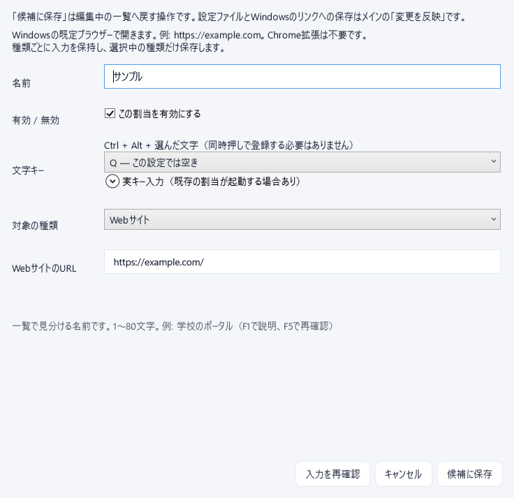
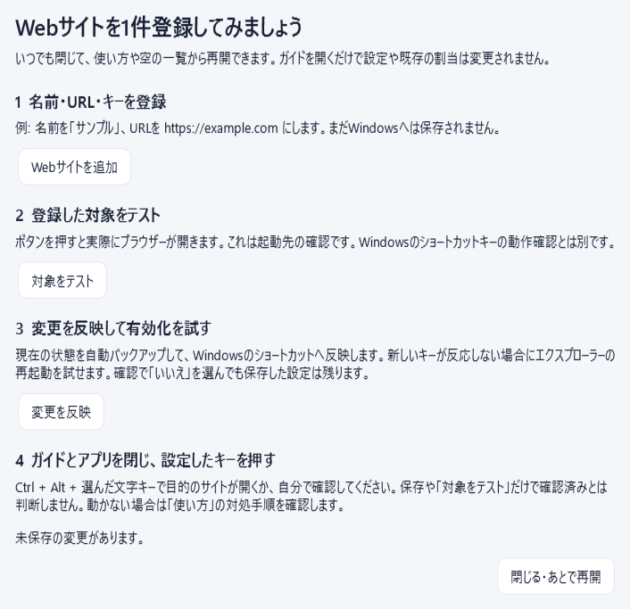
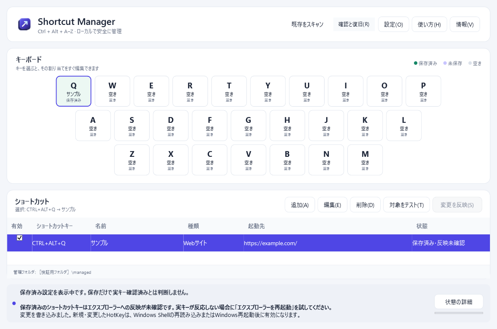

# Webサイトをショートカットキーで開く

[v1.0.0の公開ページ](https://github.com/Soki0909/windows-shortcut-manager/releases/tag/v1.0.0) から `ShortcutManager-Setup-win-x64-v1.0.0.exe` を取得し、導入後にスタートメニューの「Shortcut Manager」を開きます。Webサイト1件の登録には管理者権限、追加の.NET Runtime、Chrome拡張機能は不要です。Chromeタブグループへ割り当てる場合は [拡張の導入手順](../../README.md#クイックスタート) を参照してください。

## 1. 名前・URL・キーを登録する

初回ガイドの「Webサイトを追加」を選びます。名前に「サンプル」、WebサイトのURLに `https://example.com/` を入力します。空いている文字キーを一覧から選び、「候補に保存」を押します。例では `Q` を使っています。候補に保存すると、編集中の一覧へ戻ります。

## 2. 起動先をテストし、変更を反映する

初回ガイドの「対象をテスト」でURLが開くことを確認します。「変更を反映」を押すと、設定とWindowsの管理ショートカットへ保存されます。

## 3. Managerを閉じてキーを押す

一覧に「サンプル」の割当が表示されます。Managerとテストで開いたページを閉じ、`Ctrl+Alt+Q` を押して同じURLが開くことを確認します。反応しない場合は、ファイルのコピーや移動を終えてから、Managerの「エクスプローラーを再起動」を試してください。

画面例は候補版と同じWPF画面を匿名のサンプル設定で描画したものです。管理フォルダの表示は匿名化しています。実キーの確認結果は手順3でご自身の環境で確認できます。
